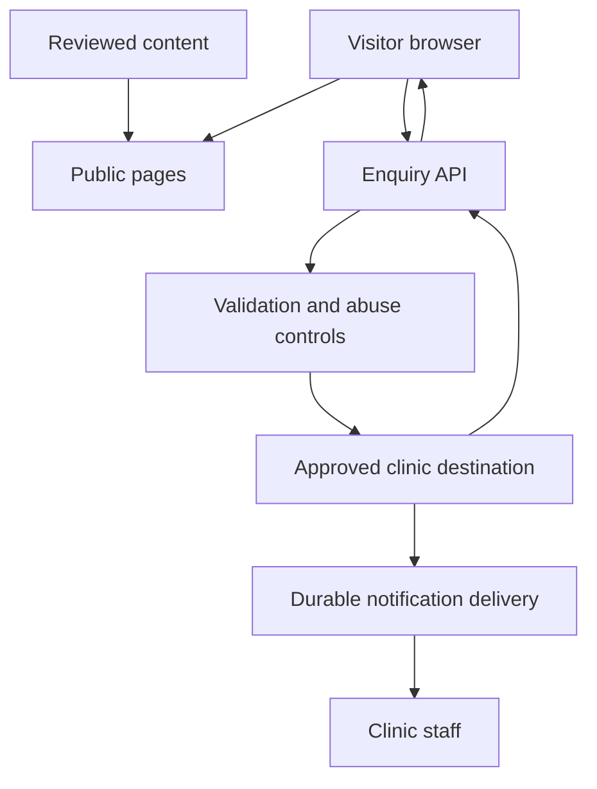

# AKSH — Technical Requirements Document

**Version:** 1.0  
**Date:** 7 October 2026  
**Implementation audience:** Claude Code and the development team  
**Companion:** AKSH_PRD.md, version 1.1  
**Status:** Implementation-ready specification with explicit integration and content launch gates.

## 1. Purpose and confirmed requirements

Implement a public wellness clinic website for AKSH with four service pillars: **Biohacking, Recovery, Body Contouring, and Skin Treatments**. Use the supplied brand palette and a warm luxury editorial design. Visitors submit an enquiry form; clinic staff manually contact them and confirm appointments.

This release includes a responsive public website, reusable content templates, and a reliable consultation request flow. Patient accounts, clinical records, medical uploads, automated clinical advice, live slot booking, and payments are outside the release.

Requirements use **MUST** for mandatory behavior, **SHOULD** for the default approach, and **MAY** for optional enhancements. This document defines implementation detail; the PRD defines product behavior. Resolve conflicts using the owner's explicit decisions, the supplied brand document, then the latest PRD. Do not silently reinterpret the scope.

### Decision register

| Decision | Status | Implementation consequence |
|---|---|---|
| Clinic website with consultation booking | Owner-confirmed | Build a public website, not management software |
| Manual clinic confirmation | Owner-confirmed | Request preferences only; no availability calendar or payment |
| Warm luxury editorial style | Owner-confirmed | Teal/ivory visual system and restrained motion |
| Exact six-colour palette | Owner-supplied document | Use the main palette without substituting its optional alternative |
| Cormorant Garamond / Manrope | First-choice fonts selected from supplied document | Headings/body respectively; alternatives are not loaded |
| Next.js App Router / TypeScript | Technical default, not owner-confirmed | Use for a new project; preserve a suitable existing project |
| Repository-managed content | Initial default | No CMS subscription or admin dashboard assumed |
| Lead storage, notifications, CMS, hosting provider | Not yet supplied | Build adapter boundaries; require real configuration before launch |
| Individual treatments, doctor, city, contact details, prices | Not yet supplied | Keep unknown facts draft or omitted |

Do not transfer WordPress/database requirements from the owner's other websites to AKSH.

## 2. Stack and dependency policy

| Layer | New-project default | Requirement |
|---|---|---|
| Application | Next.js App Router | Server-render public content; Node-compatible server runtime for enquiry handlers |
| Language | TypeScript | Strict type checking; no unchecked boundary data |
| UI | React as supported by the chosen Next.js release | Small client components; no full-site SPA conversion |
| Styling | Tailwind CSS plus CSS custom properties | Central brand tokens; retain an existing suitable styling system |
| Content | Validated TypeScript/JSON; trusted editorial Markdown/MDX | Separate content from layouts; draft/published gating |
| Validation | Zod or existing equivalent | Runtime validation for environment, content, form, and provider responses |
| Phone parsing | Maintained international phone library | Canonical E.164 value; country-aware validation |
| Form state | React state or existing form library | Avoid a large state library for one form |
| Unit/integration tests | Existing runner, otherwise Vitest | Focus on validation, publication guards, API, adapters, and failures |
| Browser tests | Playwright | Core journeys and representative responsive/browser checks |
| Content editing | Repository initially | Add approved CMS through a content adapter if staff editing is required |
| Enquiry destination | Approved clinic system through adapter | Durable retention and atomic idempotency required |

Before installation, inspect `AGENTS.md`, repository files, lockfile, existing versions, scripts, and integrations. Preserve unrelated work. Use one package manager: the existing manager, or pnpm for a new repository. Pin its version in `packageManager` and commit one lockfile. Pin a supported Node release compatible with the selected framework in the project and hosting runtime. Use stable compatible packages; avoid undocumented upgrades and unneeded dependencies.

Use actual scripts from the installed versions. Do not assume older framework commands such as a framework-specific lint command still exist; provide a direct supported lint script.

## 3. Architecture and boundaries



- Public pages read content through `ContentRepository`; they MUST NOT access lead records.
- Browser form submissions call a same-origin API. Provider credentials stay on the server.
- API input, provider responses, and CMS responses are untrusted until validated.
- Destination acceptance means a request is durably retained and retrievable by authorised staff. An email send response alone does not meet this requirement.
- Notifications occur through the destination's built-in reliable mechanism or a durable outbox/queue associated with the approved destination.
- External storage or paid services MUST NOT be silently selected. A destination that cannot provide atomic idempotency requires an approved durable integration store before it can be used.

### Project structure

```text
src/
  app/
    layout.tsx
    page.tsx
    about/page.tsx
    about/doctor/page.tsx
    how-it-works/page.tsx
    treatments/page.tsx
    treatments/[pillar]/page.tsx
    treatments/[pillar]/[slug]/page.tsx
    diagnostics/page.tsx
    diagnostics/[slug]/page.tsx
    programs/page.tsx
    programs/[slug]/page.tsx
    concerns/page.tsx
    journal/page.tsx
    journal/[slug]/page.tsx
    faq/page.tsx
    contact/page.tsx
    book/page.tsx
    book/confirmation/page.tsx
    privacy/page.tsx
    terms/page.tsx
    booking-policy/page.tsx
    medical-disclaimer/page.tsx
    api/consultation-requests/route.ts
    not-found.tsx
    error.tsx
    robots.ts
    sitemap.ts
  components/
    ui/
    layout/
    sections/
    templates/
    booking/
  content/
    clinic.ts
    pillars/
    treatments/
    diagnostics/
    programs/
    journal/
    policies/
  lib/
    content/
    booking/
    security/
    analytics/
    config/
  styles/tokens.css
public/
  images/
  fonts/
tests/
  unit/
  integration/
  e2e/
```

Route folders define templates; they do not imply draft collections are public. Implement conditional publication and real 404 behavior. Create a short architecture decision record covering framework/runtime, content source, approved destination, and deployment platform when each becomes known.

## 4. Rendering, routing, and caching

| Route family | Rendering/data policy | Cache policy |
|---|---|---|
| Home, About, process, category pages, FAQ, Contact | Server-rendered; static generation when repository data permits | Public content may be cached; rebuild on repository content change |
| Treatment/diagnostic/program/article detail | Shared server templates; validated published entry only | Cache only public approved content |
| CMS-backed public pages, if enabled | Validated server reads | Explicit bounded revalidation; verify invalidation on unpublish |
| `/book` | Server shell with client form | Public shell MUST NOT embed visitor data; do not cache any session-specific output |
| `/book/confirmation` | Server verifies short-lived receipt proof | `Cache-Control: private, no-store`; noindex |
| Enquiry API | Server runtime only | `Cache-Control: no-store`; no request/response caching |
| Draft preview | Local development or authenticated preview only | Private, no-store, noindex; access control required for shared previews |

Do not rely on undocumented framework cache defaults. Verify behavior against the installed framework release. Do not use a static-only export for the complete product: the enquiry API and private receipt handling need a server runtime unless moved into a separately approved backend.

- Valid pillar route parameters are `biohacking`, `recovery`, `body-contouring`, and `skin`.
- Unknown pillar or unpublished/mismatched treatment returns HTTP 404, not a generic successful page.
- Validate that a treatment belongs to the pillar in its route.
- Use one canonical URL per entry and a consistent trailing-slash policy.
- Generate navigation and sitemap from the same published-entry queries.
- Omit empty optional collections from navigation. Their public routes return 404 until enabled with approved content.
- Public essential text MUST remain readable without client hydration. With JavaScript disabled, the booking page explains that the interactive form requires JavaScript and provides verified contact alternatives where available.
- Handle content-fetch failure separately from a missing record: do not turn a provider outage into a false 404. Serve only previously approved cached content when available; otherwise use a retryable unavailable response.
- Unpublishing CMS content MUST invalidate its cached detail, listings, metadata, and sitemap. Do not continue serving stale withdrawn content because of a general stale-cache fallback.

## 5. Brand implementation

The authoritative source is `AKSH_Brand_Palette_and_Fonts.docx`. Encode the main palette centrally:

```css
:root {
  --aksh-teal: #123C3F;
  --aksh-ivory: #F5EFE6;
  --aksh-gold: #B8975F;
  --aksh-sage: #A8B8A6;
  --aksh-clay: #C98B72;
  --aksh-charcoal: #1F2523;

  --color-background: var(--aksh-ivory);
  --color-text: var(--aksh-charcoal);
  --color-brand: var(--aksh-teal);
  --color-cta: var(--aksh-gold);
  --color-cta-text: var(--aksh-charcoal);
  --content-max-width: 80rem;
  --control-min-height: 2.75rem;
  --radius-card: 1rem;
}
```

Use approximately 60% ivory, 25% teal, 10% sage, and 5% gold/clay together as visual guidance. Navigation/footer and selected hero areas use teal; gold highlights the primary CTA. Do not introduce the source document's optional cool-white/copper theme.

| Role | Font | Loading requirement |
|---|---|---|
| Display headings | Cormorant Garamond | Small weight subset, generous readable sizing, serif fallback |
| Body/forms/navigation | Manrope | Regular/medium/semibold as required; sans-serif fallback |
| Interim wordmark | Jost | One needed weight; use supplied logo instead when available |

Use framework font optimisation or licensed local files, retain licence notices, and avoid runtime font downloads from third-party stylesheet URLs. Do not load optional alternate families. Tokenise spacing, typography, transitions, and focus styles; arbitrary repeated hex values in components are prohibited.

Use charcoal labels on gold buttons. Add a teal boundary on ivory where necessary. Gold text on ivory is not a body-text pairing. Measured opaque-colour contrast: ivory/teal 10.54:1, charcoal/ivory 13.64:1, charcoal/gold 5.66:1; gold/ivory 2.41:1. Test actual opacity, hover/focus states, images, and gradients independently.

Validate layouts at 360, 390, 768, 1024, and 1440px. Use fluid heading sizes, at least 16px body/form text, approximately 20px mobile gutters, and controls at least 44px tall as the product target. Preserve all four service cards without a required carousel. No horizontal overflow or sticky content obscuring form focus. Motion SHOULD be CSS-based and brief; reduced-motion mode removes nonessential animation. No scroll hijacking or animation-gated text.

## 6. Content schemas and publication

These TypeScript contracts are architectural examples; implement runtime schemas and concrete fields before use.

```ts
type PillarId = 'biohacking' | 'recovery' | 'body-contouring' | 'skin';
type PublicationStatus = 'draft' | 'published' | 'archived';

interface SEOFields {
  title: string;
  description: string;
  socialImage?: string;
}

interface EditorialMeta {
  status: PublicationStatus;
  approvedBy?: string;
  approvedAt?: string; // ISO-8601 UTC timestamp
  reviewedAt?: string;
  updatedAt: string;
}

interface ImageAsset {
  src: string;
  width: number;
  height: number;
  alt: string; // empty only for genuinely decorative images
  source: 'clinic' | 'licensed' | 'prototype';
  licenceReference?: string;
}

interface ServicePillar extends EditorialMeta {
  id: PillarId;
  title: string;
  summary: string;
  introduction: string;
  image?: ImageAsset;
  faqs: Array<{ question: string; answer: string }>;
  seo: SEOFields;
}

interface Treatment extends EditorialMeta {
  id: string;
  slug: string;
  pillarId: PillarId;
  title: string;
  overview: string;
  process?: string;
  suitability?: string;
  duration?: string;
  downtime?: string;
  preparation?: string;
  aftercare?: string;
  price?: { amountMinor: number; currency: string; qualifier?: string };
  image?: ImageAsset;
  faqs: Array<{ question: string; answer: string }>;
  relatedTreatmentIds: string[];
  seo: SEOFields;
}
```

### Additional models

| Model | Required shape/constraints |
|---|---|
| ClinicSettings | AKSH name; verified site URL/contact details/address/hours when supplied; IANA clinic timezone; booking mode `request`; optional real logo and approved social links |
| Doctor | Verified name/credentials/registration where applicable, approved bio, real portrait, publication/review metadata; never generated identity |
| Diagnostic | Stable ID/slug, title, reviewed overview/process/preparation, FAQs, image, SEO and editorial metadata |
| Program | Stable ID/slug, title, reviewed overview/components/process, valid related treatment IDs, SEO and editorial metadata |
| Article | Unique slug, title/excerpt/body, category, author, reviewer when appropriate, publication/update dates, approved image/references, SEO and editorial metadata |
| Policy | Fixed policy slug, title, approved body, version, effective date, editorial metadata |

`ContentRepository` MUST expose typed queries for published lists and public detail lookup. Draft access is a separate authenticated/development function, not a `?preview=true` bypass. Validate content at build time for repository content and at the adapter boundary for CMS content.

Checks MUST cover unique IDs/slugs, slug format, valid relationships, required approved metadata, image dimensions/rights, valid dates, exact pillar mapping, and published policy presence at launch. Individual treatment names from the old sitemap are draft candidates, not confirmed offerings.

Optional empty fields are omitted from the interface. No invented prices or clinical instructions. A published page must not be assembled from a published entry and an unreviewed draft fragment. Sanitise external HTML; allowlist link protocols. MDX is executable code and is allowed only from a trusted repository/editor workflow; untrusted CMS content must not execute MDX or arbitrary scripts.

Repository content changes require a rebuild. If browser-based staff editing is requested, implement the same contract over an approved CMS with editor/reviewer permissions, preview controls, and tested publish/unpublish invalidation. No public admin interface is included by default.

## 7. Enquiry form and client state

### Fields

| Field | Client and server behavior |
|---|---|
| `name` | Required; trim; 1–100 characters after trimming; allow Unicode; reject control characters |
| `phone` / `phoneCountry` | Required raw phone up to 40 characters plus ISO country code; normalise with phone library to E.164; client country selector |
| `email` | Optional; trim; empty becomes absent; maximum 254 characters; syntactic validation |
| `interest` | Required enum: four pillar IDs or `not-sure` |
| `treatmentId` | Optional; must be published and belong to `interest`; not permitted with `not-sure` |
| `preferredDate` | Optional real calendar date in `YYYY-MM-DD`; compare with clinic-local today, not UTC today |
| `preferredTimePeriod` | Optional enum: `morning`, `afternoon`, `no-preference`; never interpreted as a reservation |
| `contactConsent` | Required literal `true`; unchecked UI default |
| `marketingConsent` | Optional boolean; default false; hide unless approved marketing workflow exists |
| `consentVersion` | Required version of the approved notice displayed on the form; server verifies accepted version |
| `source` | Optional allowlisted CTA position; no arbitrary referral URL or free-text attribution |

No symptoms, medical history, diagnosis, uploaded files, or unrestricted notes. The phone country default must come from approved clinic settings or a neutral selector, not from unrelated project locations. No promised response time without an owner-supplied value.

### State and navigation

Use a small state machine: `idle → validating → submitting → succeeded | failed | acceptance-unknown`. Field validation errors return to editable form state. Announce errors and place focus on the first invalid field. Disable duplicate submission while an attempt is running; retain values on recoverable errors.

Keep contact and selected-treatment state in memory only. For context-aware CTAs, pass the validated pillar/treatment through a lightweight in-memory provider during client navigation to `/book`. Do not put treatment interest or contact fields into query parameters, analytics, localStorage, or sessionStorage. A full reload may safely reset the optional prefill; the visitor can choose again.

Generate one UUID idempotency key per submission attempt. Reuse it for exact retries and lookup reconciliation. After a definite validation failure with no accepted request, an edited payload starts a new attempt. After an uncertain timeout, do not silently issue a new key: first reconcile the original attempt. Do not automatically repeat submissions after a page reload.

On success navigate to the generic `/book/confirmation` URL with no receipt ID or contact details in the URL. Clear form values only after acceptance is established.

## 8. API contract

### Endpoint

`POST /api/consultation-requests`

Required headers: `Content-Type: application/json`, `Idempotency-Key: <UUID>`, and `X-AKSH-Form: consultation`. Browser requests are same-origin; provider tokens are never sent by the browser. The custom header is an origin-control aid, not authentication.

```ts
interface ConsultationRequestPayload {
  name: string;
  phone: string;
  phoneCountry: string;
  email?: string;
  interest: PillarId | 'not-sure';
  treatmentId?: string;
  preferredDate?: string;
  preferredTimePeriod?: 'morning' | 'afternoon' | 'no-preference';
  contactConsent: true;
  marketingConsent?: boolean;
  consentVersion: string;
  source?: 'homepage' | 'category' | 'treatment' | 'contact' | 'direct';
  botToken?: string; // only for the configured challenge provider
}

type SuccessResponse = {
  ok: true;
  receiptId: string; // opaque identifier; no personal data
  message: 'Your consultation request has been received.';
  replayed: boolean;
};

type ErrorResponse = {
  ok: false;
  code: string;
  message: string;
  fieldErrors?: Partial<Record<keyof ConsultationRequestPayload, string>>;
  retryAfterSeconds?: number;
};
```

The payload includes no client-controlled status, creation timestamp, notification recipient, provider URL, or request ownership. Use a strict allowlisted schema. Store canonical phone/email values, not repeated raw input. Errors MUST NOT echo submitted values.

| HTTP status | Error code/meaning | Client action |
|---|---|---|
| 201 | First durable acceptance | Show receipt |
| 200 | Accepted replay of same key and payload | Show original receipt |
| 400 | `MALFORMED_REQUEST` | Show general input error |
| 403 | `ORIGIN_REJECTED` / `BOT_CHECK_FAILED` | Explain failure; allow legitimate retry without inventing acceptance |
| 409 | `IDEMPOTENCY_CONFLICT` | Stop automatic retry; reconcile original attempt |
| 413 | `PAYLOAD_TOO_LARGE` | Reject without processing |
| 415 | `UNSUPPORTED_MEDIA_TYPE` | Reject unsupported content types |
| 422 | `VALIDATION_FAILED` / `CONSENT_VERSION_CHANGED` | Field errors or refresh notice and obtain consent again |
| 429 | `RATE_LIMITED` | Honor `Retry-After`; preserve entered values |
| 503 | `DESTINATION_UNAVAILABLE` / `ACCEPTANCE_PENDING` / `BOOKING_UNCONFIGURED` | Retain values; safe same-key retry; no success receipt |
| 500 | `INTERNAL_ERROR` | Generic message; safe retry/reconciliation, no personal error output |

All responses use `Cache-Control: no-store`. Unsupported methods return 405. No public GET endpoint lists, retrieves, or modifies lead records.

### Processing order

1. Check application mode, body size, method, content type, trusted origin, and abuse limits before expensive work.
2. Parse and validate the strict structural schema; normalise persisted fields; compute a keyed fingerprint.
3. Look up the idempotency key in the approved durable destination. A matching accepted record returns its receipt; a conflicting fingerprint returns 409. Replays must not fail merely because today's date or the current consent version changed after original acceptance.
4. For a new attempt, validate current business rules: consent version, published treatment relationship, clinic-local date, optional bot challenge, and configured destination readiness.
5. Atomically accept the request or observe the winner of a concurrent same-key attempt. Record permission/version/timestamps and arrange durable notification delivery.
6. After durable acceptance, issue receipt proof and return success. If acceptance is uncertain, reconcile by the original key and never create another request under a new key.

Do not use email addresses or phone numbers as idempotency keys. Validate provider response schemas and treat an invalid/ambiguous response as uncertain, not automatically successful.

## 9. Destination, persistence, and notification contracts

```ts
type StoredReceipt = {
  receiptId: string;
  acceptedAt: string;
  payloadFingerprint: string;
};

type LookupResult =
  | { kind: 'accepted'; receipt: StoredReceipt }
  | { kind: 'pending' }
  | { kind: 'missing' };

type AcceptResult =
  | { kind: 'accepted'; receipt: StoredReceipt; replayed: boolean }
  | { kind: 'conflict' }
  | { kind: 'pending' };

interface ConsultationDestination {
  lookupByKey(key: string): Promise<LookupResult>;
  accept(command: {
    idempotencyKey: string;
    payloadFingerprint: string;
    request: NormalizedConsultationRequest;
  }): Promise<AcceptResult>;
}
```

Define `NormalizedConsultationRequest` with the approved fields from section 7, canonical phone/email, server-generated UTC creation time, consent text/version/timestamp, and request status `new`. Staff workflow states MAY later be `contacted`, `appointment-confirmed`, `closed`, and `spam` in the approved system; these are not publicly writable.

### Logical persistence requirements

The approved destination MUST support equivalents of:

- Unique opaque request ID.
- Unique idempotency key and stored payload fingerprint.
- Validated contact/preference fields and permission record.
- Creation time and restricted staff status.
- Notification job ID/state, attempts, next retry time, and non-personal last error code.

These are logical requirements, not authorisation to create a new database. Use a provider's atomic create-if-absent/idempotency feature or an approved transactional integration store. An application-memory map, JSON file on a serverless filesystem, browser storage, or email-only flow does not satisfy production durability.

Fingerprint normalised persisted fields with a server-side keyed HMAC. Exclude rotating bot tokens and transport headers. A repeated key with changed contact/preference/permission fields conflicts; never overwrite the accepted record. Retain deduplication data for at least the supported retry window; default retry window is 24 hours, bounded by the approved retention policy. Document any provider limits. Browser automatic retries must remain within this window.

Apply an 8-second starting timeout to destination writes and a 3-second timeout to reconciliation lookups, configurable for the selected provider. Bound the complete handler to a 15-second application deadline and configure the host's request duration to permit that budget. Prefer one controlled reconciliation over a chain of blind writes. A client network timeout is not proof of server cancellation or provider rejection. Once the provider may have received a write, an abort/timeout remains uncertain until lookup resolves it. Do not attach request cancellation to a durable notification worker.

### Notifications

Use the destination's reliable notification capability, or atomically commit an outbox event alongside the lead. Do not send notifications in an unawaited promise after returning from a serverless function. Workers claim jobs safely, reuse a stable notification ID, and record completed delivery.

Default retry schedule for transient delivery errors: 1 minute, 5 minutes, 30 minutes, 2 hours, then 12 hours. After exhaustion mark the job failed and raise an operational alert. Adjust to the approved provider's capabilities; permanent recipient/configuration errors should alert without repeated sends. Treat ambiguous delivery responses carefully and use provider deduplication where available.

Notification failure after lead acceptance MUST NOT turn acceptance into failure or create another lead. Staff must still find the original lead in the destination. Notifications SHOULD contain a generic new-enquiry alert and a link to the authenticated clinic system rather than patient details in email/WhatsApp. Email/WhatsApp recipients and providers are owner-configured, never hardcoded or derived from user input.

## 10. Receipt integrity and demo mode

### Production receipt

After durable acceptance, set a signed short-lived receipt proof cookie, e.g. `aksh_receipt`, through the response handler. Payload contains only opaque receipt ID, issue/expiry time, and environment audience—no contact, service, or medical fields. Use a server-only signing secret; validate signature and expiry. Production cookie: HttpOnly, Secure, SameSite=Lax, Path=`/book/confirmation`, maximum age 15 minutes.

The server-rendered receipt page checks the proof before showing receipt language. Missing/invalid/expired proof redirects to `/book` or renders a neutral request page. Directly opening `/book/confirmation` must not imply successful submission. The cookie proves acceptance at issuance; it must not claim current appointment status or expose staff records. Disable cache and analytics for this page. Redact cookies from monitoring. Rotate secrets with a documented short overlap where needed.

### Application modes

| Mode | Allowed behavior |
|---|---|
| `development` | Labelled demo adapter allowed; synthetic records only |
| `preview` | Protected, noindex preview; demo receipt explicitly says no request was sent; production credentials prohibited |
| `production` | Real approved adapter required; demo acceptance prohibited |

Use explicit `APP_MODE`, not `NODE_ENV` alone: hosted previews may also use a production framework build. Demo proof uses a distinct cookie/audience and cannot pass production verification. A production form with missing configuration shows an unavailable state and verified contact options; its API returns 503 without simulation. This is a functional fail-safe, not approval to launch with a broken primary enquiry flow.

## 11. Security and privacy

### Transport and origin controls

- Enforce HTTPS in production and exact allowed origins from server configuration.
- Browser API accepts JSON and the required custom header. Reject cross-origin, `Origin: null`, and missing-origin requests for this browser-only endpoint. Automated tests set a valid test origin. Keep CORS disabled for arbitrary origins.
- Check Fetch Metadata headers where present as additional defense. Do not trust caller-supplied forwarded IP headers unless the hosting proxy documents and strips/replaces them.
- If a future integration adds credentialed cross-site writes or authenticated staff actions, add appropriate CSRF/session protection and authorisation; the public form is not a staff API.
- Server outbound destinations are allowlisted server configuration. Never fetch a user-submitted provider URL; do not follow redirects to an unapproved origin.

### Abuse controls

Enforce a streamed/request body cap of **16 KiB** and strict schema/length limits. Starting rate-limit policy: **5 new submission attempts per 10 minutes per trusted client IP-derived key**, with bounded retry allowance for existing keys. Keep policy configurable and validate against legitimate shared networks. HMAC IP-derived keys with a server secret; store only short-lived rate-limit state, not raw IPs in the application lead record.

Rate limiting must use a host/provider distributed control or approved shared service. A per-process counter is insufficient across multiple instances. Use a bot challenge only when configured; verify its token on the server for the intended site/action. No fake success for spam or failed challenges. Define fail-closed behavior when required abuse controls are unavailable and test it.

### Data handling

- No form bodies, contact fields, treatment selection, receipt cookies, or provider credentials in logs/traces/error reports.
- Turn off session replay and form capture. Redact query strings and request headers in monitoring.
- Restrict destination access to authorised staff, with audit capabilities where supplied.
- Store data encrypted in transit and using the approved destination's at-rest controls.
- Define owner-approved retention, deletion, backup behavior, and access removal. No invented legal retention period or claim of automatic compliance.
- Exclude requests from public CMS exports and source-controlled fixtures. Use synthetic test data in isolated test destinations.
- Use context-safe encoding and parameterised writes in any approved database adapter. Sanitize external rich text; disallow arbitrary executable embeds.

### Headers

Configure a tested Content Security Policy restricted to actual asset/challenge/analytics hosts. No wildcard script origins or `unsafe-eval` in production. Use framework-compatible nonces/hashes if necessary and assess their rendering/cache implications. Also configure `X-Content-Type-Options: nosniff`, CSP `frame-ancestors`, a restrictive Permissions Policy, and an appropriate Referrer Policy. Prefer `no-referrer` on booking/receipt routes. Enable HSTS only after the production domain and HTTPS are verified. Test headers against fonts, images, menus, and form submission; do not ship a policy that breaks the interface.

## 12. SEO, media, accessibility, and measurement

### SEO implementation

Use one metadata helper for titles, descriptions, canonical URLs, and social assets. Set the canonical base from validated production site configuration; never canonicalise to a preview hostname. Give each public page a meaningful H1 and unique metadata. Generate public-only sitemap entries with genuine content update dates.

Receipts, previews, and draft/private content are noindex. Robots directives are not data access control. Verified clinic data may support appropriate structured data and breadcrumbs; never generate ratings, credentials, or locality from missing facts. Serialize JSON-LD safely. Use genuine 404 responses for unpublished/unknown content and intentional redirects only for moved URLs.

### Media and fonts

Use framework image optimisation or an equivalent responsive pipeline, real intrinsic dimensions, modern supported formats, and responsive `sizes`. Prioritise the actual hero/LCP asset; lazy-load lower sections. Start with a ≤250 KiB mobile hero image target and inspect visual quality. Avoid autoplay hero video, initial map iframes, and unlicensed/identity-misrepresenting imagery. Map/directions links use approved coordinates/address only.

### Accessibility

Target WCAG 2.2 AA. Implement semantic landmarks, skip link, logical headings, useful alt text, visible unobscured focus, keyboard interactions, readable contrast, accessible menu/dialog behavior, and labelled form inputs. Errors use an accessible summary and field association; submission status uses an appropriate live region. Do not communicate status through colour alone. Respect reduced motion. Validate at 200% zoom and narrow reflow as well as the specified viewport widths.

### Performance targets

| Target | Acceptance measurement |
|---|---|
| Mobile Lighthouse 90+ in four categories | Representative public routes in production build; record tool version/profile; report median of three runs |
| LCP ≤2.5s, INP ≤200ms, CLS ≤0.1 | Field targets evaluated at the 75th percentile when sufficient real-user data exists; lab tests do not prove INP/field performance |
| Minimal initial client work | Client code only for needed interactions; review bundle report and expensive third parties |
| Stable layout | Explicit media dimensions and font fallback sizing; no animation-induced shifts |

These are release targets, not guarantees. Diagnose actual slow assets/components before adding infrastructure.

### Optional analytics

Analytics is off until configured with a consent mechanism and approved collection policy. Allowlist general events and CTA position only. Never transmit contact data, receipt IDs, treatment/concern selection, medical information, arbitrary URLs, or form values. No advertising pixels, session replay, or analytics SDK on `/book` or `/book/confirmation` in the default release. If general form-start/success counts are later required, specify and approve a minimal collection method before enabling it; default receipt/form tracking remains disabled. Scrub sensitive page paths if an approved measurement tool collects them automatically.

Operational counters may record API outcome class, processing duration, error code, queue failures, and adapter readiness without visitor data. Operational health endpoints, if needed, are protected or restricted by the platform and reveal no secrets/provider response bodies.

## 13. Configuration and environments

Validate configuration on the server at startup/build as appropriate. Do not expose secrets through `NEXT_PUBLIC_*`. Public settings contain only intentionally public clinic/content values.

| Setting | Purpose | Gate |
|---|---|---|
| `APP_MODE` | development / preview / production | Always required; production explicitly set |
| `SITE_URL` | Canonical public origin | Verified live origin required for production |
| `ALLOWED_ORIGINS` | Exact enquiry origin allowlist | Required for enabled production form |
| `CLINIC_TIMEZONE` | Valid IANA timezone | Required when date preferences are enabled |
| `CONTENT_SOURCE` | repository / approved CMS adapter | Default repository |
| `CONSULTATION_ADAPTER` | demo / approved adapter name | Demo prohibited in production |
| `CONSULTATION_API_URL` | Approved destination endpoint, if relevant | Server-only validated allowlisted origin |
| `CONSULTATION_API_TOKEN` | Destination authentication, if relevant | Secret; required for that adapter |
| `DESTINATION_TIMEOUT_MS` / `LOOKUP_TIMEOUT_MS` | Bounded outbound calls | Defaults 8000 / 3000; within the handler/host budget |
| `RECEIPT_SIGNING_SECRET` | Receipt proof | Secret; required for accepted receipts |
| `IDEMPOTENCY_HMAC_SECRET` | Keyed payload fingerprints | Secret; stable across supported retry period |
| `RATE_LIMIT_DRIVER` / driver secrets | Distributed abuse controls | Required for enabled production form |
| `RATE_LIMIT_HMAC_SECRET` | Short-lived IP-derived limit keys | Secret |
| `CONSENT_NOTICE_VERSION` | Approved contact permission notice | Must match approved policy/content |
| Notification configuration | Provider-specific recipients/template IDs | Required if destination does not own notifications |
| Optional CMS/bot/analytics settings | Only selected integrations | Validate only enabled integration settings |

No dummy production secrets, domains, phone numbers, or credentials. Do not put unpublished contact details into `.env.example`; provide variable names and neutral placeholders. Configure secret rotation without invalidating pending retries unexpectedly.

Use separate destination credentials and synthetic records for preview/testing. Production browser/monitoring configuration must not inherit debug collection. Feature toggles derive from approved content readiness and integration configuration, not hidden user-controlled URL parameters.

## 14. Testing and CI

Provide scripts equivalent to `dev`, `build`, `start`, `lint`, `typecheck`, `test`, `test:e2e`, `validate:content`, and `validate:release`. Exact commands follow the repository's installed tooling.

### Required tests

| Area | Mandatory cases |
|---|---|
| Validation | Unicode name, empty/oversized fields, invalid international phone/email, unknown fields, malformed JSON, invalid date, timezone day boundary, bad enum/consent |
| Publication | Draft/archived exclusion, slug/relationship validation, optional collection hiding, wrong pillar detail, unpublish invalidation where CMS is used |
| API | 201 acceptance, 200 replay, 409 changed-payload conflict, 422 errors, 403 origin/bot failure, 413/415 limits, 429, unconfigured production 503 |
| Idempotency | Concurrent same-key submissions result in one retained lead; lost response after acceptance reconciles to original receipt; new-payload conflict does not overwrite |
| Destination | Responses validated; known outage vs uncertain acceptance; provider timeout; staff can retrieve synthetic accepted lead |
| Notification | Acceptance survives notification failure; durable retry after worker interruption; exhaustion alert; no duplicate lead from delivery retry |
| Receipt | Direct URL, invalid/expired cookie, production/demo audience mismatch, valid acceptance, private no-store headers |
| Privacy | No form payload in logs/analytics/storage/URLs; no lead data in public API/content build; secret bundle scan |
| Browser | Home → pillar → detail when approved → enquiry; prefill/edit; mobile menu; visible form errors; failure preserves values; retry; keyboard and reduced motion |

Run essential flow tests on Chromium; smoke-test Firefox and WebKit. Review representative layout/form states at 360, 390, 768, 1024, and 1440px. Automated accessibility scans supplement, not replace, keyboard/focus/zoom checks. Fixtures must use visibly synthetic data and a designated test destination.

### CI sequence

1. Install from lockfile with pinned runtime/package manager.
2. Lint and typecheck.
3. Validate content/publication rules.
4. Run focused unit and API/adapter integration tests.
5. Build production bundle.
6. Run browser and representative accessibility checks against that build.
7. Run release validation for the intended environment. Content-limited protected previews may pass preview checks while explicitly failing production readiness.

Do not suppress failing checks or weaken assertions to claim readiness. Produce a concise validation report identifying tests actually run versus pending provider/credential-dependent checks.

## 15. Deployment, operations, and launch gates

Document deployment for the approved host. The complete product requires a Next.js-compatible server runtime or an approved equivalent backend, HTTPS, secret injection, distributed abuse controls, and a durable request destination. Do not prescribe or purchase a hosting provider without owner selection.

Deploy a protected preview with isolated test integrations first. Verify production-like cache/security headers, provider timeouts, content publication, and receipt integrity. Configure the real domain/canonical origin only after confirmation. Record build/deployment version and a rollback path.

Monitor generic API failure counts, destination readiness, notification backlog/failures, and public route availability. Thresholds must be set against expected traffic rather than invented high-volume assumptions. Alerts contain operational error codes and authenticated system links, not contact details.

A rollback should restore a known working application build while preserving retained leads. Adapter/schema changes must remain compatible with pending notification jobs and idempotent retries. If the lead system supplies backup/restore, document ownership and retrieval/deletion procedures; do not claim backups exist without verification.

### Production launch gates

- Approved public clinic details, policies/consent notice, assets, and published service copy.
- Verified domain, contact links, timezone/date handling, metadata, and sitemap.
- Real approved destination with durable retention, concurrency-safe idempotency, staff access, and tested retrieval.
- Approved notification mechanism; tested delivery failure/retry path.
- Production secret configuration, rate limiting, origin protection, receipt signing, and no demo adapter.
- Required tests/build/browser checks passed; no unexplained critical accessibility/security failures.
- Owner-provided retention/access process and confirmed operational responsibility.

Missing individual treatment details need not stop the four category pages if their general copy is approved. Missing destination/consent configuration blocks production enquiry launch. Missing optional Journal, Diagnostics, and Programs content keeps those collections hidden. Missing logo can use a clearly accepted text wordmark; it must not be represented as a final designed logo without approval.

### PRD acceptance traceability

| PRD criteria | Technical implementation/check |
|---|---|
| AC-01, AC-03 | Four enum-backed routes; shared typed detail templates |
| AC-02, AC-13 | Validated content, editorial status, publication/404/sitemap guards |
| AC-04, AC-15, AC-16 | Responsive navigation, keyboard/focus/reflow and reduced-motion checks |
| AC-05, AC-06 | Memory-only CTA prefill; shared schema plus server business validation |
| AC-07, AC-08, AC-09, AC-10 | Durable request adapter, safe timeout reconciliation, atomic idempotency, manual-confirmation wording |
| AC-11 | Data minimisation, tracking/log redaction, private receipts, secret-boundary checks |
| AC-12, AC-14 | Verified clinic settings, real contact links, canonical metadata and robots/sitemap rules |
| AC-17, AC-18 | CI checks, integration retrieval test, and production release validation gates |

## 16. Deliverables and Claude Code execution instructions

Deliver runnable code, validated structured content, reusable templates, documented adapters, `.env.example` without secrets, setup/build instructions, content editing guidance, architecture decisions, tests, and a release readiness report. Do not deploy until instructed.

Execute in this order:

1. Inspect repository/instructions and record stack assumptions.
2. Build central brand tokens, layouts, publication schemas, and four-pillar pages.
3. Implement reusable detail templates and optional collections behind publication guards.
4. Implement request validation, state machine, API, idempotency/destination adapter, and receipt verification.
5. Connect approved integrations when supplied; otherwise provide clearly labelled demo/testing and a production unavailable state.
6. Finish SEO, accessibility, security, and measured performance work.
7. Complete checks and document actual launch blockers.

### Ready-to-use Claude Code prompt

```text
Build the AKSH website using AKSH_PRD.md and AKSH_Technical_Requirements.md.
Inspect the repository and AGENTS.md first. Preserve a suitable existing stack;
otherwise use the documented Next.js/TypeScript defaults with pinned tooling.

Use the exact supplied six-colour palette, Cormorant Garamond headings, and
Manrope body/UI text. The visual direction is warm luxury and editorial.
Build Biohacking, Recovery, Body Contouring, and Skin Treatments as four
clear service pillars with reusable reviewed-content templates.

Booking is an enquiry form with manual clinic confirmation. Implement the
documented schema, API, server validation, durable destination adapter,
idempotent retries, notification reliability, and verified receipt page.
Never show production success before durable acceptance. Do not add live
appointment slots, payment, patient accounts, or medical intake.

Do not invent clinic facts or silently select a CMS, external database,
notification provider, or paid host. Keep missing content draft and optional
collections hidden. Complete independent implementation while credentials
are unavailable; make demo mode explicit and production fail safely.

Run the required checks and report what passed, what was not runnable, and
exact production launch blockers. Deliver working code and setup/content/
integration/deployment documentation. Do not stop after planning and do not
deploy until instructed.
```

## 17. Reference sources

Project inputs: owner's confirmed selections; `AKSH_PRD.md` version 1.1; `AKSH_Brand_Palette_and_Fonts.docx`; earlier AKSH sitemap treated as draft architecture.

Technical references reviewed on 7 October 2026; use documentation matching the installed framework/package versions:

- [Next.js Route Handlers](https://nextjs.org/docs/app/api-reference/file-conventions/route)
- [Next.js Server and Client Components](https://nextjs.org/docs/app/getting-started/server-and-client-components)
- [Next.js cookies API](https://nextjs.org/docs/app/api-reference/functions/cookies)
- [Next.js backend for frontend guidance](https://nextjs.org/docs/app/guides/backend-for-frontend)
- [Zod documentation](https://zod.dev/)
- [Playwright documentation](https://playwright.dev/docs/intro)
- [OWASP input validation guidance](https://cheatsheetseries.owasp.org/cheatsheets/Input_Validation_Cheat_Sheet.html)
- [OWASP CSRF prevention guidance](https://cheatsheetseries.owasp.org/cheatsheets/Cross-Site_Request_Forgery_Prevention_Cheat_Sheet.html)
- [WCAG 2.2](https://www.w3.org/TR/WCAG22/)
- [Web Vitals](https://web.dev/articles/vitals)

This specification defines website engineering requirements; it does not determine clinical suitability, validate treatment claims, or assert regulatory compliance.
